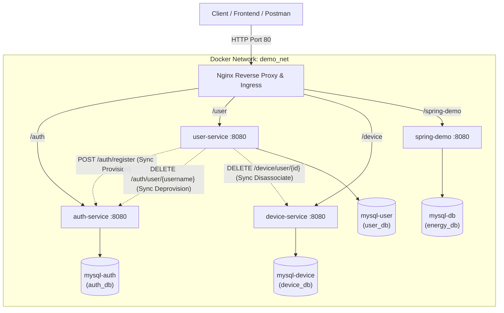

# Energy Management System – Comprehensive Architectural & Technical Report

**Institution:** Technical University of Cluj-Napoca (UTCN)  
**Course:** Distributed Systems (Assignment 1)  
**Architecture Paradigm:** Containerized Microservices & Request-Reply Communication  
**Technology Stack:** Java 25 (LTS), Spring Boot 4.1.1, Hibernate 7, MySQL 8.4 (LTS), Nginx Alpine, Docker & Docker Compose  

---

## 1. Architectural Overview & System Design

The system implements an **Energy Management System** enabling role-based access for Administrators (full CRUD on user accounts, energy devices, and their associations) and Clients (monitoring assigned smart metering devices).

Rather than utilizing a monolithic topology, the solution implements an enterprise-grade **Microservices Architecture** strictly conforming to the **Database-per-Service** pattern. External consumers communicate through a centralized **Reverse Proxy / API Gateway** (Nginx) operating on standard HTTP Port 80.



---

## 2. Ingress & Reverse Proxy Layer (Nginx)

The reverse proxy represents the single point of entry into the microservice fabric, isolating the internal Docker bridge network (`demo_net`) from external exposure.

### Technical Configuration (`nginx/nginx.conf`)
* **Upstream Clusters**: Defines four distinct internal upstream targets (`auth_service`, `user_service`, `device_service`, `spring_demo`), resolving to their respective Docker internal DNS names on port `8080`.
* **Path-Based Multiplexing**:
  * `/auth` ➔ Proxied to `http://auth_service` (`auth-service:8080`)
  * `/user` ➔ Proxied to `http://user_service` (`user-service:8080`)
  * `/device` ➔ Proxied to `http://device_service` (`device-service:8080`)
  * `/spring-demo` ➔ Proxied to `http://spring_demo` (`spring-demo:8080`)
  * `/health` ➔ Direct response (`200 OK - 'nginx ok'`) for container orchestration health checks.
* **Header Preservation**: Forwards client metadata (`Host`, `X-Real-IP`, `X-Forwarded-For`, `X-Forwarded-Proto`) to ensure auditability across downstreams.

---

## 3. Microservices Specification

Each microservice is built following a clean, layered architectural pattern:
`Controller (REST Web API)` ➔ `Service (Business Rules & Orchestration)` ➔ `Repository (Data Access)` ➔ `JPA Entities & DTOs`.

### A. Authorization Microservice (`auth-service`)
* **Responsibility**: Identity verification, credential persistence, secure password hashing, and token issuance.
* **Database Isolation**: Dedicated schema `auth_db` hosted in container `mysql-auth`.
* **Cryptographic Security**:
  * **Password Storage**: Passwords are never stored in plaintext. They are encrypted using `BCryptPasswordEncoder` with a salted work factor of 10.
  * **Token Generation**: Generates cryptographically signed **JSON Web Tokens (JWT)** via `JJWT 0.12.6` signed with HMAC-SHA256 (`Keys.hmacShaKeyFor`). Tokens encapsulate `sub` (username), `role` (`ADMIN` | `CLIENT`), and `userId`.
* **Exposed Endpoints**:
  * `POST /auth/register`: Ingests `RegisterRequestDTO`, hashes password, saves `Credential` entity, returns UUID.
  * `POST /auth/login`: Verifies username and validates password hash match; emits JWT bearer token.
  * `DELETE /auth/user/{username}`: Internal synchronization endpoint for credential cleanup.

---

### B. User Management Microservice (`user-service`)
* **Responsibility**: Lifecycle management of user profiles and orchestrator for cross-service data consistency.
* **Database Isolation**: Dedicated schema `user_db` hosted in container `mysql-user`.
* **Core Entity**:
  * `User`: Contains `id` (`BINARY(16)` UUID), `name`, `username` (unique), `password`, and `role`.
* **Inter-Service Request-Reply Synchronization**:
  * Employs Spring's non-blocking, modern `RestClient` configured with environment URLs (`DEVICE_SERVICE_URL: http://device-service:8080`, `AUTH_SERVICE_URL: http://auth-service:8080`).
  * **On User Registration (`POST /user`)**: Automatically executes synchronous `POST /auth/register` to provision identity credentials.
  * **On User Deletion (`DELETE /user/{id}`)**:
    1. Removes user entity from `user_db`.
    2. Synchronously invokes `DELETE /device/user/{id}` on `device-service` to disassociate all meters.
    3. Synchronously invokes `DELETE /auth/user/{username}` on `auth-service` to revoke credentials.
* **Exposed Endpoints**:
  * `GET /user`: Returns collection of `UserDTO`s.
  * `GET /user/{id}`: Returns specific `UserDTO` by UUID.
  * `POST /user`: Creates user entity and triggers credential synchronization.
  * `PUT /user/{id}`: Updates user attributes.
  * `DELETE /user/{id}`: Deletes user and triggers distributed cascading synchronization.

---

### C. Device Management Microservice (`device-service`)
* **Responsibility**: Ingestion, cataloging, and user-association mapping for smart energy metering devices.
* **Database Isolation**: Dedicated schema `device_db` hosted in container `mysql-device`.
* **Core Entity**:
  * `Device`: Contains `id` (`BINARY(16)` UUID), `name`, `description`, `max_consumption` (double precision), and `user_id` (`BINARY(16)` UUID).
  * **Distributed Data Reference**: Uses a loose, logical reference column (`user_id`) without physical foreign key constraints, adhering to distributed systems decoupling rules.
* **Association & Disassociation Logic**:
  * `unassignDevicesForUser(userId)`: Executed via `@Transactional` to update all devices referencing `userId` to `NULL`, maintaining inventory records while breaking defunct user associations.
* **Exposed Endpoints**:
  * `GET /device`: Lists all devices (Admin).
  * `GET /device/{id}`: Returns single device by UUID.
  * `GET /device/user/{userId}`: Filters and returns only devices associated with a specific client UUID (Client role).
  * `POST /device`: Registers a new device.
  * `PUT /device/{id}`: Modifies device configuration or consumption thresholds.
  * `DELETE /device/{id}`: Removes device from inventory.
  * `PATCH /device/{deviceId}/assign/{userId}`: Associates device with a client account.
  * `DELETE /device/user/{userId}`: Internal synchronization endpoint for bulk unlinking.

---

### D. Reference Microservice (`spring-demo-java25`)
* **Responsibility**: Retained baseline implementation managing `Person` entities, validating backward compatibility and multi-app orchestration.
* **Database Isolation**: Dedicated schema `energy_db` in `mysql-db`.

---

## 4. Containerization & Orchestration Architecture

The system is deployed using **Docker Compose v2** declared in [`docker-compose.yml`](file:///C:/Users/Daniel/Desktop/UTCN/An4/Sem1/SD/Project1/docker-compose.yml).

### Multi-Stage Container Packaging
All microservices implement an optimized multi-stage container build strategy:
1. **Builder Stage**: Image `maven:3.9-eclipse-temurin-25`. Fetches dependencies offline, compiles application code, extracts Spring Boot JarLauncher layers (`dependencies`, `spring-boot-loader`, `snapshot-dependencies`, `application`).
2. **Runtime Stage**: Image `eclipse-temurin:25-jre`. Runs under an unprivileged system user (`spring`), optimizing security, disk footprint, and cold-start latency.

### Complete Port Mapping Matrix

| Container Name | Internal Service | Container Port | Host Port | Ingress via Nginx (Port 80) | Network |
| :--- | :--- | :--- | :--- | :--- | :--- |
| **`nginx-proxy`** | Nginx Reverse Proxy | `80` | **`80`** | **`http://localhost/`** | `demo_net` |
| **`auth-service`** | Authentication API | `8080` | **`8083`** | `http://localhost/auth` | `demo_net` |
| **`user-service`** | User Management API | `8080` | **`8081`** | `http://localhost/user` | `demo_net` |
| **`device-service`** | Device Management API | `8080` | **`8082`** | `http://localhost/device` | `demo_net` |
| **`spring-demo`** | Reference Demo API | `8080` | **`8084`** | `http://localhost/spring-demo` | `demo_net` |
| **`mysql-auth`** | Auth MySQL 8.4 Server | `3306` | **`3310`** | Database only (`auth_db`) | `demo_net` |
| **`mysql-user`** | User MySQL 8.4 Server | `3306` | **`3308`** | Database only (`user_db`) | `demo_net` |
| **`mysql-device`** | Device MySQL 8.4 Server | `3306` | **`3309`** | Database only (`device_db`) | `demo_net` |
| **`mysql-db`** | Demo MySQL 8.4 Server | `3306` | **`3307`** | Database only (`energy_db`) | `demo_net` |

### Persistence & Automated Database Seeding
* Data directories are mapped to named Docker volumes (`mysql-auth-data`, `mysql-user-data`, `mysql-device-data`, `mysql-data`).
* Automatic initialization scripts in [`db-init/`](file:///C:/Users/Daniel/Desktop/UTCN/An4/Sem1/SD/Project1/db-init) are mounted to `/docker-entrypoint-initdb.d/init.sql` for automated schema and baseline data pre-population:
  * **Admin Account**: `admin` / `admin123` (UUID: `11111111-1111-1111-1111-111111111111`, Role: `ADMIN`)
  * **Test Client Account**: `client1` / `client123` (UUID: `22222222-2222-2222-2222-222222222222`, Role: `CLIENT`)
  * **Sample Smart Meters**: 3 devices (2 mapped to Client `22222222-2222-2222-2222-222222222222`, 1 unassigned).

---

## 5. End-to-End API Specification

All requests are dispatched to **`http://localhost`** (Nginx Gateway):

```
+--------+----------------------------+-------------------------------------+-----------------------------------+-------------+
| Method | Endpoint                   | Sample Payload                      | Sample Response                   | Status Code |
+--------+----------------------------+-------------------------------------+-----------------------------------+-------------+
| POST   | /auth/login                | {"username":"admin",                | {"token":"eyJ...",                | 200 OK      |
|        |                            |  "password":"admin123"}             |  "username":"admin",              |             |
|        |                            |                                     |  "role":"ADMIN",                  |             |
|        |                            |                                     |  "userId":"11111111..."}          |             |
+--------+----------------------------+-------------------------------------+-----------------------------------+-------------+
| POST   | /auth/register             | {"username":"user1",                | "4a2b9f10-..."                    | 201 Created |
|        |                            |  "password":"secret",               |                                   |             |
|        |                            |  "role":"CLIENT"}                   |                                   |             |
+--------+----------------------------+-------------------------------------+-----------------------------------+-------------+
| GET    | /user                      | None                                | [{"id":"1111...",                 | 200 OK      |
|        |                            |                                     |   "name":"System Administrator",  |             |
|        |                            |                                     |   "username":"admin",             |             |
|        |                            |                                     |   "role":"ADMIN"}]                |             |
+--------+----------------------------+-------------------------------------+-----------------------------------+-------------+
| POST   | /user                      | {"name":"John", "username":"johnd", | "c3b88a91-..."                    | 201 Created |
|        |                            |  "password":"pass", "role":"CLIENT"}|                                   |             |
+--------+----------------------------+-------------------------------------+-----------------------------------+-------------+
| DELETE | /user/{id}                 | None                                | None                              | 204 No Cont |
+--------+----------------------------+-------------------------------------+-----------------------------------+-------------+
| GET    | /device                    | None                                | [{"id":"3333...",                 | 200 OK      |
|        |                            |                                     |   "name":"Smart Meter Living",    |             |
|        |                            |                                     |   "maxConsumption":450.5,         |             |
|        |                            |                                     |   "userId":"2222..."}]            |             |
+--------+----------------------------+-------------------------------------+-----------------------------------+-------------+
| GET    | /device/user/{userId}      | None                                | [{"id":"3333...", ...}]           | 200 OK      |
+--------+----------------------------+-------------------------------------+-----------------------------------+-------------+
| PATCH  | /device/{id}/assign/{uId}  | None                                | Updated DeviceDTO                 | 200 OK      |
+--------+----------------------------+-------------------------------------+-----------------------------------+-------------+
```
