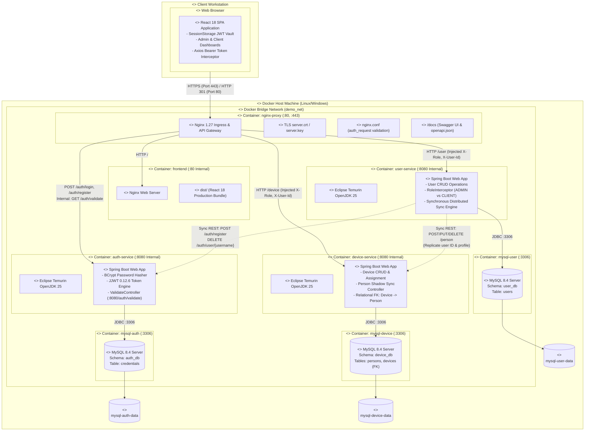

# Energy Management System — UML Deployment Documentation

**Institution:** Technical University of Cluj-Napoca (UTCN)  
**Course:** Distributed Systems (Assignment 1)  
**Deliverable Requirement:** *UML Deployment diagram and solution description*  
**Diagram Files:**
- [`deployment-diagram.puml`](deployment-diagram.puml) (PlantUML source)
- [`deployment-diagram.svg`](deployment-diagram.svg) (High-resolution vector visual)

---

## 1. Architectural Deployment Diagram

---

## 2. Deployment Nodes & Component Inventory

### 2.1 Node: `Client Workstation`
- **Device Type:** End-User Computer / Mobile Device.
- **Execution Environment:** Modern Standards-Compliant Web Browser (Chrome, Firefox, Safari, Edge).
- **Artifact:** `React 18 Single-Page Application (SPA)`.
  - Stored in browser cache / DOM memory.
  - Interacts with backend exclusively over HTTPS port 443 through JSON REST APIs.
  - Stores JWT access token and user claims inside `sessionStorage`.

---

### 2.2 Node: `Docker Host Machine`
The host operating system (Linux or Windows 10/11 with WSL2 engine) running Docker Engine and Docker Compose v2.

#### A. Internal Network Topology (`demo_net`)
- Private bridge network isolating container-to-container traffic.
- Containers resolve each other through automatic Docker internal DNS (`auth-service`, `user-service`, `device-service`, `frontend`, `mysql-auth`, `mysql-user`, `mysql-device`).
- Only **port 80** and **port 443** of `nginx-proxy` are published to external consumers. Databases publish ports for administration (`3308`, `3309`, `3310`), but normal traffic passes through the internal bridge.

#### B. Execution Environments (Containers)

| Container Name | Base Image | Role / Execution Environment | Exposed / Mapped Ports |
|---|---|---|---|
| **`nginx-proxy`** | `nginx:alpine` | Reverse Proxy, API Gateway, TLS Termination, JWT Validation filter | Host `80:80`, `443:443` |
| **`frontend`** | `nginx:alpine` (multi-stage from `node:20`) | Static Web Server hosting React 18 production build | Internal `80` |
| **`auth-service`** | `eclipse-temurin:25-jre` (multi-stage from `maven:3.9`) | Spring Boot 4 REST API, JJWT, BCrypt | Internal `8080`, Host `8083` |
| **`user-service`** | `eclipse-temurin:25-jre` (multi-stage from `maven:3.9`) | Spring Boot 4 REST API, User Management, Distributed Sync | Internal `8080`, Host `8081` |
| **`device-service`**| `eclipse-temurin:25-jre` (multi-stage from `maven:3.9`) | Spring Boot 4 REST API, Device Management, Person Shadow Table | Internal `8080`, Host `8082` |
| **`mysql-auth`** | `mysql:8.4` | Relational Database for Credentials (`auth_db`) | Internal `3306`, Host `3310` |
| **`mysql-user`** | `mysql:8.4` | Relational Database for Users (`user_db`) | Internal `3306`, Host `3308` |
| **`mysql-device`**| `mysql:8.4` | Relational Database for Devices & Persons (`device_db`) | Internal `3306`, Host `3309` |

#### C. Persistent Storage Volumes
To guarantee zero data loss across container lifecycle restarts:
- **`mysql-auth-data`** ➔ Mapped to `/var/lib/mysql` inside `mysql-auth`.
- **`mysql-user-data`** ➔ Mapped to `/var/lib/mysql` inside `mysql-user`.
- **`mysql-device-data`** ➔ Mapped to `/var/lib/mysql` inside `mysql-device`.

Automated SQL dump scripts in [`db-init/`](db-init/) are mounted as read-only volumes to `/docker-entrypoint-initdb.d/init.sql` for automated zero-config database provisioning.

---

## 3. Communication Protocols & Security Boundaries

1. **Client-to-Gateway (Public WAN / LAN Boundary):**
   - Protocol: **HTTPS / TLS 1.3** on port 443 with high-cipher encryption (AES-256-GCM / ChaCha20-Poly1305).
   - Port 80 automatically responds with an HTTP `301 Moved Permanently` directing traffic to `https://$host$request_uri`.
   - Credentials submitted via HTTP `POST` body (never query parameters or URL strings).
   - JWT token transmitted in standard header: `Authorization: Bearer <token>`.

2. **Gateway-to-Auth Service Token Validation Sub-request:**
   - Nginx uses the native `auth_request` module to issue a synchronous sub-request to `GET /auth/validate` on `auth-service`.
   - `auth-service` decodes and verifies the HMAC-SHA256 signature and timestamp.
   - On success, claims are returned in response headers (`X-User-Id`, `X-Username`, `X-Role`).
   - Nginx intercepts these headers and forwards them downstream to `user-service` and `device-service`.

3. **Inter-Microservice Synchronous Coordination:**
   - Communication: Synchronous REST via Spring Boot `RestClient` over internal HTTP port 8080.
   - Strong Consistency Guarantee: When a user is registered, updated, or deleted in `user-service`, synchronous calls update `auth-service` and `device-service` within the transactional scope.

4. **Service-to-Database:**
   - Protocol: Standard MySQL Protocol over TCP port 3306 via `mysql-connector-j` driver with connection pooling (HikariCP).
